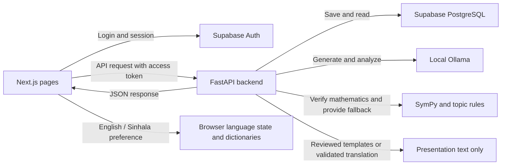

# MathRoot AI — simple viva guide

MathRoot helps teachers create Mathematics tests and helps students understand their mistakes. Read these two guides in order:

**For the actual code-by-code files:** [Frontend source index](frontend/SOURCE_INDEX.md) · [Backend source index](backend/SOURCE_INDEX.md). The folder structure matches the application, and each `.tsx`, `.ts`, `.css` or `.py` source has its own `.md` explanation with real code blocks.

1. [Frontend: pages, buttons and API calls](frontend/README.md)
2. [Backend: permissions, mathematics, AI and saved results](backend/README.md)

Each guide explains the current source files and their main functions. Repeated starter code is explained once, with links to every member's folder.

**Viva introduction:** “MathRoot uses Next.js for the interface, FastAPI for application logic, Supabase for authentication and saved data, and Ollama for AI assistance. Mathematical rules determine correctness, so the system can still give feedback when AI fails.”

The frontend displays results; the backend decides grades and permissions; the database preserves progress. Only Binomial Expressions is ready. The other four topic folders are development starters.

## English and Sinhala, simply explained

There is one Mathematics test, with one set of question IDs, option IDs and correct answers. The existing language selector changes only what the user reads. `frontend/lib/i18n/LanguageProvider.tsx` remembers the preference using `mathroot.language`, exposes the translation hook and updates the document language. `en.ts` and `si.ts` hold application-owned interface wording.

The backend keeps its saved English questions and feedback. `backend/app/presentation.py` adds Sinhala display fields to responses. `topics/development/binomial/presentation.py` supplies reviewed templates for Binomial instructions, explanations and possible misconceptions. These work in manual mode without AI. Optional provider hooks can translate other prose only after mathematical notation checks and topic-owned approval of the meaning; missing/invalid translations keep English and show a warning. No new database tables or separate language-specific answer keys are needed.

**Viva explanation:** “I separate presentation from mathematical identity. Language changes labels and explanations, while the saved question, selected option and deterministic grade remain unchanged. Reviewed templates provide reliable Sinhala fallback.”

Use the existing source indexes for code-by-code explanations of the new helpers and the changed pages. The [frontend guide](frontend/README.md) explains switching and browser checks; the [backend guide](backend/README.md) explains response metadata, translation guards and historical records.

The source indexes mark every file created or modified for bilingual support with **bilingual**. Matching code blocks and line ranges were checked against all 37 changed/new source files; local links in the updated Markdown were also checked. Existing source explanations and topic instructions are preserved alongside the new language details.

For startup commands, see [ports and commands](ports-and-commands.md). For deeper implementation details, see [answer verification](answer-verification.md) and [topic contracts](TOPIC_CONTRACT.md).
