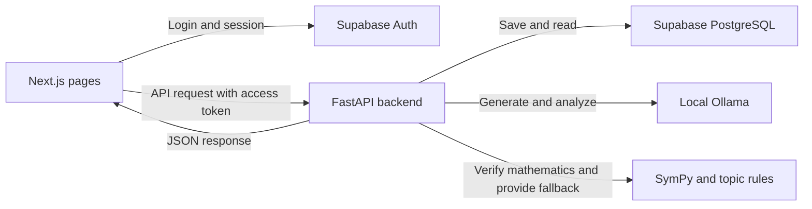

# MathRoot AI — simple viva guide

MathRoot helps teachers create Mathematics tests and helps students understand their mistakes. Read these two guides in order:

**For the actual code-by-code files:** [Frontend source index](frontend/SOURCE_INDEX.md) · [Backend source index](backend/SOURCE_INDEX.md). The folder structure matches the application, and each `.tsx`, `.ts`, `.css` or `.py` source has its own `.md` explanation with real code blocks.

1. [Frontend: pages, buttons and API calls](frontend/README.md)
2. [Backend: permissions, mathematics, AI and saved results](backend/README.md)

Each guide explains the current source files and their main functions. Repeated starter code is explained once, with links to every member's folder.

**Viva introduction:** “MathRoot uses Next.js for the interface, FastAPI for application logic, Supabase for authentication and saved data, and Ollama for AI assistance. Mathematical rules determine correctness, so the system can still give feedback when AI fails.”

The frontend displays results; the backend decides grades and permissions; the database preserves progress. Only Binomial Expressions is ready. The other four topic folders are development starters.

For startup commands, see [ports and commands](ports-and-commands.md). For deeper implementation details, see [answer verification](answer-verification.md) and [topic contracts](TOPIC_CONTRACT.md).
